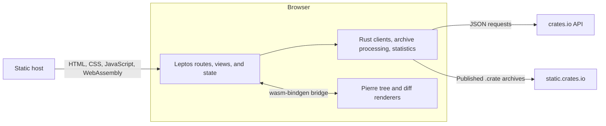

# Architecture

crate-diff is a browser application for discovering Rust crates and comparing
their published source archives. Rust and Leptos own routing, application state,
network requests, archive processing, and file change statistics. Vanilla
JavaScript components from Pierre render the file tree and source diff.

The application uses Leptos client-side rendering and compiles to WebAssembly.
A static host serves the application and its assets. Metadata and archives are
requested directly from crates.io services; the project has no application
backend or persistent browser database. Display preferences use `localStorage`;
downloaded metadata and source files remain in memory.

## Documentation map

| Document | Covers |
| --- | --- |
| [Data flow](data-flow.md) | Home and search requests, version resolution, archive processing, comparison statistics, caching, and errors |
| [Frontend and build](frontend.md) | Component ownership, header portal, Pierre integration, theming, build outputs, hosting, and validation |
| [Display settings](settings.md) | Appearance, workspace layout, diff schemes and size, font discovery/preview, persistence, and cross-tab updates |

## Source responsibilities

| Source | Responsibility |
| --- | --- |
| [`src/main.rs`](../src/main.rs) | Mounts the Leptos application into the document body |
| [`src/app.rs`](../src/app.rs) | Shared header, routed main content, and comparison header context |
| [`src/views/`](../src/views/) | Page orchestration and asynchronous loading states |
| [`src/components/`](../src/components/) | Reusable forms, cards, navigation, comparison controls, tree, and diff panel |
| [`src/data.rs`](../src/data.rs) | Shared crate metadata, home summary client, formatting, and external link handling |
| [`src/search.rs`](../src/search.rs) | Search response types, pagination size, search URLs, and search requests |
| [`src/diff.rs`](../src/diff.rs) | Ordered version metadata, archive clients and caches, verified extraction, file classification, and line statistics |
| [`src/components/pierre.rs`](../src/components/pierre.rs) | Rust bindings to browser renderer functions and renderer cleanup |
| [`src/settings.rs`](../src/settings.rs) and [`js/settings.js`](../js/settings.js) | Typed bindings and the shared display preference store |
| [`js/fonts.js`](../js/fonts.js) and [`js/settings-values.js`](../js/settings-values.js) | Font discovery/stacks and available diff schemes/defaults |
| [`js/pierre.js`](../js/pierre.js) | Pierre instances, tree selection synchronization, and visual diff rendering |
| [`style.css`](../style.css) | Shared neutral palette, responsive layout, and renderer host styling |
| [`scripts/build-ui.mjs`](../scripts/build-ui.mjs) | esbuild configuration for Pierre modules and highlighting assets |
| [`scripts/wasm-size.mjs`](../scripts/wasm-size.mjs) | Packaged WebAssembly sizes and estimated compressed transfer sizes |

## Routes and URL state

The route table lives in [`src/app.rs`](../src/app.rs). Static page routes are
declared before the crate routes.

| Route | View and behavior |
| --- | --- |
| `/` | `Home`: summary lists and registry search on Enter |
| `/debug` | `DebugPage`: cache inventory/size and localStorage diagnostics, linked from About |
| `/404`, or an unmatched route | `NotFound` |
| `/search/:query` | `SearchPage`: an encoded, nonblank search term; optional `?page=N` |
| `/browse/:krate/:version` | `BrowsePage`: redirects to `/crate/:krate/:version/:version` to browse source |
| `/crate/:krate` | `DiffPage`: resolves previous/latest and redirects to concrete version strings |
| `/crate/:krate/:old/:new/*file` | `DiffPage`: resolves the comparison and optionally selects a file |

The comparison wildcard also matches an empty file path. Both the version root
and a selected file use the same route definition, allowing the sidebar to stay
mounted during file navigation.

The header's Settings button opens a shared dialog with Settings and About tabs.
About contains project information and a Debug link to `/debug` within the app.

Search query/page and comparison crate/version/file selections are URL state.
Filters, changed-files-only, split/unified mode, expanded context, and retry
counters are local component state. Local state survives only while its owning
component remains mounted. Selecting a different file creates a new diff panel;
the sidebar filters remain in the existing workspace.
Display preferences are shared across routes and persisted across reloads.

## Current execution model

Downloads are asynchronous, but archive decompression, extraction, Rust line
statistics, and the configured JavaScript rendering run on the browser's main
thread. The integration does not configure a worker pool. Large comparisons
therefore share the UI thread with these operations.

Files stay in memory. The source cache is bounded by entry count, and each
archive has a 128 MiB extracted-file-size limit. These limits do not establish a
total browser memory budget: active comparisons, downloaded compressed bytes,
and renderer data can exist alongside cached files.

For installation and development commands, see the [project README](../README.md).
