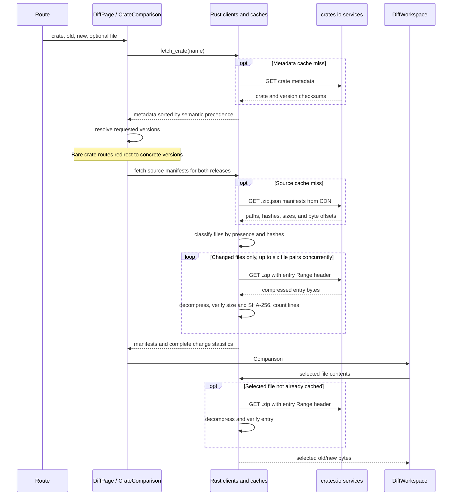

# Data flow

## Home and search

[`Home`](../src/views/home.rs) loads
`https://crates.io/api/v1/summary` through
[`fetch_summary`](../src/data.rs). The home page displays the Most Downloaded
and Just Updated lists; other response fields are ignored. Home provides a
central search field and hides the header search. Typing only changes its draft,
leaving these lists unchanged. Pressing Enter navigates to the registry search
page, which has its own search form and submit button. The home form omits the
submit button.

[`SearchPage`](../src/views/search.rs) provides its own search form and hides the
header search. It separates the editable input from the query in the URL:

1. Input updates the local draft immediately.
2. A cancelable 500 ms timeout updates the query route and resets pagination.
   Typing uses history replacement; submitting the form cancels the timeout
   and navigates immediately without replacement.
3. A `LocalResource` requests
   `https://crates.io/api/v1/crates?q={query}&per_page=20&page={page}` through
   [`fetch_search`](../src/search.rs).
4. The response is paired with its requested query and page. The view checks
   that identity against the current URL before rendering results.
5. [`SearchResults`](../src/components/search_results.rs) reuses `CrateCard`,
   reads `meta.total`, and builds Previous/Next links.

Bare `/search` and blank query URLs show the standard not-found page without
making a search request. Clearing the search input returns home.
Missing, invalid, or zero page numbers
are treated as page 1. Page numbers and query text are preserved in shareable
links. Pending input timeouts are canceled when the query changes through
navigation or the component is disposed.

Home and search use resource-local results rather than the comparison caches
described below. Network and response errors render retry controls.

## Comparison loading

[`DiffPage`](../src/views/diff.rs) loads metadata separately from source manifests.

The metadata resource depends on the crate name and metadata retry counter.
Changing the selected file does not start another metadata request.

Inside `CrateComparison`, a memo resolves the requested old/new versions. The
source resource depends on that resolved pair and its own retry counter. Two
different releases load concurrently with `futures::join!`; comparing a version
with itself loads its manifest once and shares its inventory. Changed-file contents
load with at most six file pairs in flight to compute complete sidebar counts.
Unchanged files stay unloaded until selected; identical hashes share one verified
file for both sides.

`/browse/:krate/:version` redirects to that same-version comparison. The file
tree lists all source files, and unchanged text uses the full-file renderer.
The browse route reuses version resolution, per-file verification, and caches.
With no changed files, it downloads only the manifest and selected file.

File navigation does not change the resolved pair. The version memo's equality
check avoids restarting manifest loading or line-count calculations for those navigations.

## Version precedence and resolution

[`CrateResponse`](../src/diff.rs) normalizes the version list during
deserialization. Versions are parsed once for sorting and ordered by descending
`semver::Version::cmp_precedence`.

| Input | Behavior |
| --- | --- |
| `latest` | First entry in the ordered list |
| `previous` | Second entry, or the first when only one entry exists |
| Exact version string | Exact string match, including build metadata |

This makes `1.10.0` precede `1.9.0`, a release precede its own prereleases, and
`rc.10` precede `rc.2`. Build metadata does not affect precedence; equal
precedence retains the response's relative order. Unparseable version strings
remain at the end of the list.

Yanked releases stay selectable and carry a label in the dropdowns. Resolution
does not exclude them or impose a separate stable-release policy.

A missing version or unsupported version expression produces a not-found error.

## Source manifests and range requests

[`src/source.rs`](../src/source.rs) requests
`https://static.crates.io/crates/{name}/{name}-{version}.zip.json`.
The manifest records each relative path, SHA-256, uncompressed size,
compression method (`store` or raw `deflate`), and compressed data offset/size.
The loader rejects invalid paths, duplicates, unsupported methods, invalid
hashes, overflowing ranges, manifests above 8 MiB, and inventories above
128 MiB of uncompressed content.

For a file, `fetch_file` sends a single `Range: bytes=start-end` request to the
companion `.zip`. It decompresses only that entry, bounds output to the declared
size plus one byte, and verifies both size and SHA-256 before caching. Empty
stored files need no network request. A server returning a whole ZIP with HTTP
200 is handled by slicing the requested entry; ordinary CDN responses are 206.
Range requests use `cache: no-store` so the browser's HTTP cache does not expand
successive partial requests into whole-ZIP responses. The app's verified file
cache still serves revisits without network requests.

The manifest and per-file hashes are trusted from the HTTPS CDN. The API's
`checksum` describes the Cargo `.crate` tarball, not the ZIP or manifest, so it
cannot authenticate a ZIP entry. It is used only for the legacy fallback.

A missing manifest (403 or 404) falls back to the original `.crate` archive,
which can occur before the publication background job builds the ZIP.
`unpack_source` verifies the archive against the API checksum, extracts valid
relative file paths, skips non-file entries, rejects duplicates, and enforces
the 128 MiB limit. Other errors, malformed manifests, and failed integrity
checks surface as errors rather than silently downloading a Cargo archive.

Directory structure always comes from the inventory paths; all files appear
in the sidebar even when their contents have not been downloaded.

## File classification and rendering inputs

[`compare_sources`](../src/diff.rs) walks the sorted union of manifest paths.
Presence and matching SHA-256/size determine Added, Removed, Modified, or
Unchanged status without reading unchanged contents. Rust's `Removed` status serializes as `deleted` for Pierre.

For changed text files, `similar::TextDiff::from_lines` computes the addition
and deletion counts used in the summary and sidebar. A file containing a NUL
byte or invalid UTF-8 is treated as binary; it still has a change status but
contributes no text-line counts.

[`DiffWorkspace`](../src/components/diff_workspace.rs) selects the URL's file,
otherwise `Cargo.toml` when present, otherwise the first file. Its
[`FilePanel`](../src/components/diff_view.rs) loads the selected file pair through
a separate retryable resource. `LoadedFilePanel` handles missing files, binary
file sizes, unchanged-file notices, and empty files before passing text to JavaScript.

Statistics and visual diffs are separate computations. Rust supplies file
statuses and line counts; Pierre parses the selected old/new text to render
syntax highlighting, inline changes, and folded context. The bridge does not
pass a precomputed Rust patch to Pierre. Absent files are passed as absent
values, preserving added/deleted file semantics.

## Caches and failures

The caches in [`src/diff.rs`](../src/diff.rs) and
[`src/source.rs`](../src/source.rs) are in-memory thread-local maps.

| Cache | Key | Value | Capacity behavior |
| --- | --- | --- | --- |
| Metadata | Crate name | Ordered `CrateResponse` | Clears all entries before inserting when 16 entries are already present |
| Sources | `(crate name, version)` | Manifest plus successfully loaded file contents | Clears all entries before inserting when 10 entries are already present |

Only successful results enter these caches. They have no TTL, persistent
storage, LRU eviction, or deduplication of concurrent in-flight requests.
Reloading the application clears them. A cached release skips another manifest
request, and cached files skip their range requests and decompression.

The `/debug` route, linked from the dialog's About tab, reads these maps through `cache_snapshot`. It lists
cached crate/version identities, individual entry sizes, each cache's total,
and a combined total. Metadata sizes are serialized cached JSON bytes; source
sizes include manifest response bytes and cached uncompressed file-content bytes.
Source entries also list the total inventory count, cached file count, individual
cached file paths/sizes, and whether the source format is ZIP or legacy `.crate`. These are payload sizes, excluding
allocator/container overhead and files retained elsewhere by active views.
Source keys keep the crate name and version separate, including hyphenated
crate names and prerelease versions. Metadata versions retain semantic order.

[`DebugPage`](../src/views/debug.rs) also reads all localStorage keys for the
site, including `crate-diff.settings` and `font-mono`. JSON values are expanded
for readability; other values stay strings. Blocked storage access appears
as an error in the dump. Local storage appears above crate caches; both dumps
are snapshots captured when the page opens, without changing the stored data.
The page uses escaped text and sends no diagnostic data to a service. Reloading
or opening a new document starts with empty app caches; an in-app transition
to `/debug` preserves the current cache contents.

Comparison failures use `LoadError::NotFound` or `LoadError::Message`.
[`Problem`](../src/components/problem.rs) displays those errors and, where
provided, increments the relevant retry counter. Search and home use string
errors with their own retry counters. Renderer construction failures are
displayed beside the tree or diff host.
