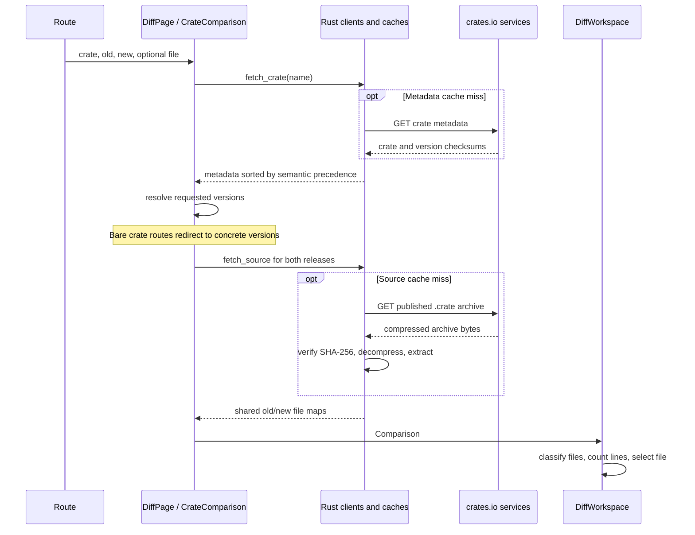

# Data flow

## Home and search

[`Home`](../src/views/home.rs) loads
`https://crates.io/api/v1/summary` through
[`fetch_summary`](../src/data.rs). The home page displays the Most Downloaded
and Just Updated lists; other response fields are ignored. Home provides a
central search field and hides the header search. Typing only changes its draft,
leaving these lists unchanged. Pressing Enter navigates to the registry search
page, which has its own search form and submit button. The home form omits the
submit button.

[`SearchPage`](../src/views/search.rs) separates the editable input from the
query in the URL:

1. Input updates the local draft immediately.
2. A cancelable 500 ms timeout updates the query route and resets pagination.
   Typing uses history replacement; submitting the form cancels the timeout
   and navigates immediately without replacement.
3. A `LocalResource` requests
   `https://crates.io/api/v1/crates?q={query}&per_page=20&page={page}` through
   [`fetch_search`](../src/search.rs).
4. The response is paired with its requested query and page. The view checks
   that identity against the current URL before rendering results.
5. [`SearchResults`](../src/components/search_results.rs) reuses `CrateCard`,
   reads `meta.total`, and builds Previous/Next links.

An empty query makes no search request. Missing, invalid, or zero page numbers
are treated as page 1. Page numbers and query text are preserved in shareable
links. Pending input timeouts are canceled when the query changes through
navigation or the component is disposed.

Home and search use resource-local results rather than the comparison caches
described below. Network and response errors render retry controls.

## Comparison loading

[`DiffPage`](../src/views/diff.rs) loads metadata separately from archives.

The metadata resource depends on the crate name and metadata retry counter.
Changing the selected file does not start another metadata request.

Inside `CrateComparison`, a memo resolves the requested old/new versions. The
source resource depends on that resolved pair and its own retry counter. Two
different releases load concurrently with `futures::join!`; comparing a version
with itself loads it once and shares the resulting file map.

File navigation does not change the resolved pair. The version memo's equality
check avoids restarting archive loading for those navigations.

## Version precedence and resolution

[`CrateResponse`](../src/diff.rs) normalizes the version list during
deserialization. Versions are parsed once for sorting and ordered by descending
`semver::Version::cmp_precedence`.

| Input | Behavior |
| --- | --- |
| `latest` | First entry in the ordered list |
| `previous` | Second entry, or the first when only one entry exists |
| Exact version string | Exact string match, including build metadata |

This makes `1.10.0` precede `1.9.0`, a release precede its own prereleases, and
`rc.10` precede `rc.2`. Build metadata does not affect precedence; equal
precedence retains the response's relative order. Unparseable version strings
remain at the end of the list.

Yanked releases stay selectable and carry a label in the dropdowns. Resolution
does not exclude them or impose a separate stable-release policy.

A missing version or unsupported version expression produces a not-found error.

## Archive processing

`fetch_source` requests
`https://static.crates.io/crates/{name}/{name}-{version}.crate`.
`unpack_source` then:

1. Checks the compressed archive's SHA-256 against the checksum from metadata.
2. Opens the gzip stream and reads its tar entries.
3. Keeps file entries and strips the expected `{name}-{version}/` prefix.
4. Rejects non-UTF-8 paths, unexpected prefixes, empty paths, empty path
   segments, `.` or `..` segments, and duplicate file paths.
5. Checks that the sum of extracted file sizes is at most 128 MiB.
6. Returns a `BTreeMap<String, Vec<u8>>`, shared through `Arc<Files>`.

Extraction stays in memory. Non-file archive entries, including directories
and symbolic links, are skipped. Directory structure in the sidebar comes from
the file paths.

## File classification and rendering inputs

[`file_changes`](../src/diff.rs) walks the sorted union of paths in both
archives. Presence and byte equality determine Added, Removed, Modified, or
Unchanged status. Rust's `Removed` status serializes as `deleted` for Pierre.

For changed text files, `similar::TextDiff::from_lines` computes the addition
and deletion counts used in the summary and sidebar. A file containing a NUL
byte or invalid UTF-8 is treated as binary; it still has a change status but
contributes no text-line counts.

[`DiffWorkspace`](../src/components/diff_workspace.rs) selects the URL's file,
otherwise `Cargo.toml` when present, otherwise the first file. Its
[`FilePanel`](../src/components/diff_view.rs) handles missing files, binary file
sizes, unchanged-file notices, and empty files before passing text to JavaScript.

Statistics and visual diffs are separate computations. Rust supplies file
statuses and line counts; Pierre parses the selected old/new text to render
syntax highlighting, inline changes, and folded context. The bridge does not
pass a precomputed Rust patch to Pierre. Absent files are passed as absent
values, preserving added/deleted file semantics.

## Caches and failures

The caches in [`src/diff.rs`](../src/diff.rs) are in-memory thread-local maps.

| Cache | Key | Value | Capacity behavior |
| --- | --- | --- | --- |
| Metadata | Crate name | Ordered `CrateResponse` | Clears all entries before inserting when 16 entries are already present |
| Sources | `(crate name, version)` | `Arc<Files>` | Clears all entries before inserting when 10 entries are already present |

Only successful results enter these caches. They have no TTL, persistent
storage, LRU eviction, or deduplication of concurrent in-flight requests.
Reloading the application clears them. A cached release skips another archive
download and extraction.

The `/debug` route, linked from the dialog's About tab, reads these maps through `cache_snapshot`. It lists
cached crate/version identities, individual entry sizes, each cache's total,
and a combined total. Metadata sizes are serialized cached JSON bytes; source
sizes are uncompressed file-content bytes. These are payload sizes, excluding
allocator/container overhead and files retained elsewhere by active views.
Source keys keep the crate name and version separate, including hyphenated
crate names and prerelease versions. Metadata versions retain semantic order.

[`DebugPage`](../src/views/debug.rs) also reads all localStorage keys for the
site, including `crate-diff.settings` and `font-mono`. JSON values are expanded
for readability; other values stay strings. Blocked storage access appears
as an error in the dump. Local storage appears above crate caches; both dumps
are snapshots captured when the page opens, without changing the stored data.
The page uses escaped text and sends no diagnostic data to a service. Reloading
or opening a new document starts with empty app caches; an in-app transition
to `/debug` preserves the current cache contents.

Comparison failures use `LoadError::NotFound` or `LoadError::Message`.
[`Problem`](../src/components/problem.rs) displays those errors and, where
provided, increments the relevant retry counter. Search and home use string
errors with their own retry counters. Renderer construction failures are
displayed beside the tree or diff host.
